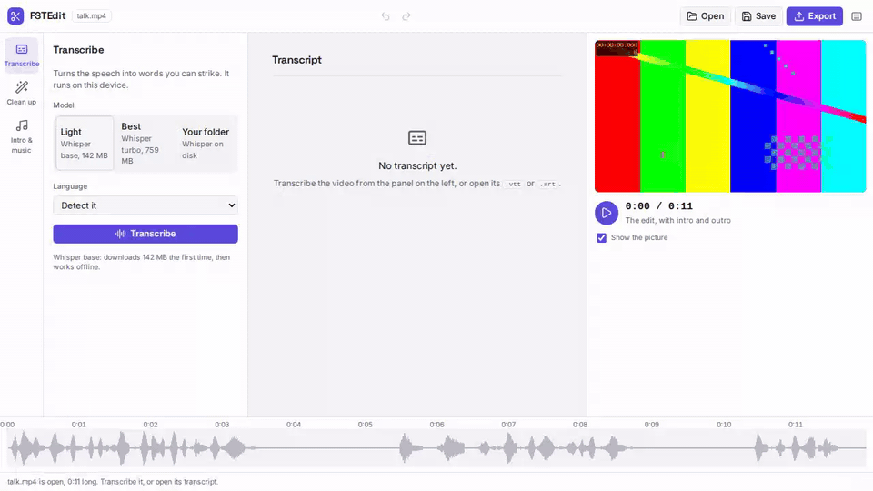
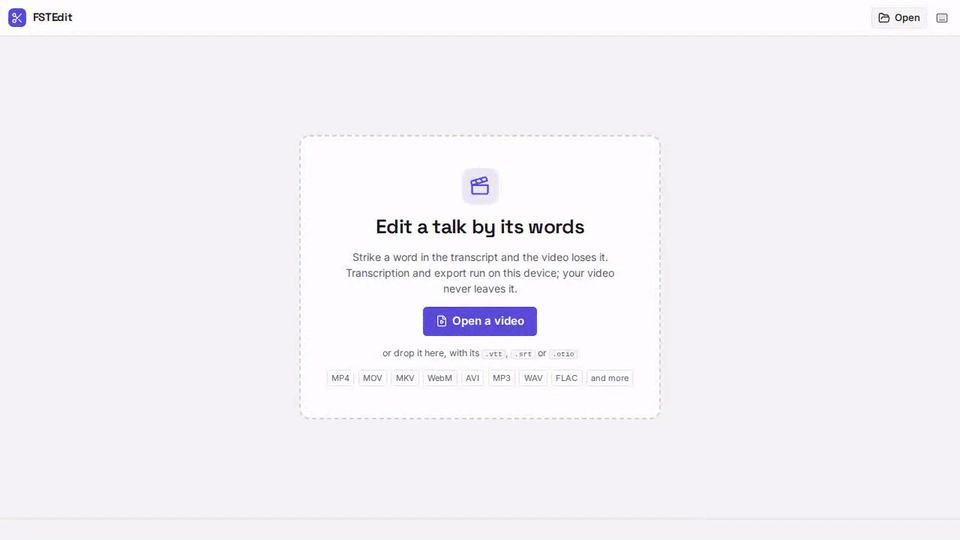
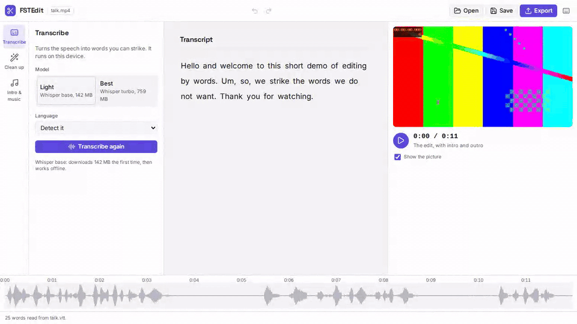

# FSTEdit

**Edit a talk by its transcript: strike a word and the video loses it. Free,
private, and it runs in your browser.**

### ▶ [**Try it live, offware-apps.github.io/FSTEdit**](https://offware-apps.github.io/FSTEdit/), no account, nothing uploaded

FSTEdit is for the videos most people actually make: a meetup talk, an
interview, a podcast. Open the recording, transcribe it, strike the "um", the
long pauses and the five minutes of setup, add your intro, outro and music, and
export. It does cuts well and nothing else: no colour grading, no transitions.

Transcription runs [Whisper](https://github.com/openai/whisper) and export runs
[ffmpeg](https://ffmpeg.org/), both on your device. Your video never leaves it,
and once the model is downloaded FSTEdit works offline.

---

## See it

> Transcribing from a Whisper model in a folder on the disk, so nothing is
> downloaded, then striking the "Um,". Recorded in headless Chromium by
> [`scripts/record-demo.mjs`](scripts/record-demo.mjs).



> Striking words and silences: a drag across "Um, so," struck with one key,
> the silences found and struck, then undone and redone. Same recorder.



> Adding an intro and music, then exporting an animated GIF. Same recorder.



---

## What it does

- **Transcribe** the talk, a time on every word. Light is Whisper base, a
  142 MB download; Best is Whisper turbo, 759 MB; Voxtral is Mistral's Voxtral
  Mini, about 2.8 GB, on the graphics chip through WebGPU; and Your folder
  loads a Whisper model already on your disk. All run on your device, show the
  time left, and say which models this browser already holds.
- **Strike** words by clicking, dragging, tapping or with the keyboard. Every
  filler word, "um", "uh", "euh", "ben", goes in one click, or one at a time
  after a look at each.
- **Find silences** longer than you choose and strike them, keeping a breath on
  either side.
- **Cut the setup** before the playhead and the chatter after it.
- **Add an intro, an outro and music.** The music repeats, fades at both ends
  and drops while someone speaks.
- **Play the edit** with all of it before anything is rendered.
- **Move a cut's edge** by dragging it on the timeline, or 10 ms at a time
  with <kbd>[</kbd> and <kbd>]</kbd>, when the transcript placed a word a
  little off.
- **Undo and redo** everything. A reload opens the last project again: its
  transcript and strikes at once, and its recording too where the browser
  keeps a link to the file, Chrome and Edge, or after one click elsewhere.
- **Export** an MP4 for YouTube or PeerTube, an M4A or MP3 for a podcast feed,
  or an animated GIF.
- **Save** the project, the transcript, or subtitles timed to the edited video.

Each cut fades the sound over 5 ms. Its edges land on the quietest 20 ms
within 150 ms of the word's edge and at most 40 ms into the word beside it,
so a join neither clicks nor clips a consonant when the transcript misplaces
a word.

## Formats

| | Formats |
| --- | --- |
| Opens | MP4, MOV, MKV, WebM, AVI, MP3, WAV, FLAC, Opus and everything else ffmpeg reads; a recording with several sound tracks keeps them all |
| Exports | MP4 in H.264 at three qualities, M4A, MP3, animated GIF |
| Saves | the project as [OpenTimelineIO](https://github.com/AcademySoftwareFoundation/OpenTimelineIO), the transcript as WebVTT or SRT |

A recording the browser cannot play, an AVI for one, gets a lighter copy to
watch while you edit. The export always reads the original.

## Private and offline

Nothing about your video leaves the device. The one request FSTEdit makes is the
model download from [Hugging Face](https://huggingface.co/onnx-community), the
first time you transcribe, after you click the button that names its size. The
browser then keeps the model, the app and the encoder, so FSTEdit opens at once
and works with the network off. A new version waits until you click **Reload to
update** in the status bar, and keeps the model, and the encoder unless the new
version changed it.

To skip even that download, choose **Your folder** and pick a folder holding a
Whisper ONNX export with word times, such as
[`whisper-base_timestamped`](https://huggingface.co/onnx-community/whisper-base_timestamped/tree/main):
its `config.json`, `generation_config.json`, `preprocessor_config.json`,
`tokenizer.json`, `tokenizer_config.json` and the `onnx/` encoder and decoder of
one precision. FSTEdit then requests nothing from any server.

## Keyboard

| Keys | Action |
| --- | --- |
| <kbd>Space</kbd> | Play or stop the edit from the selection |
| <kbd>X</kbd>, <kbd>Delete</kbd> | Strike or restore the selected words |
| <kbd>[</kbd> <kbd>]</kbd> | Move the cut edge nearest the playhead 10 ms earlier or later; the two keys right of <kbd>P</kbd> on any layout |
| <kbd>J</kbd> <kbd>K</kbd> <kbd>L</kbd> | Back 5 s, stop, play faster |
| <kbd>,</kbd> <kbd>.</kbd> | One frame back or forward |
| <kbd>Ctrl</kbd>+<kbd>Z</kbd> | Undo; with <kbd>Shift</kbd>, redo |
| <kbd>Ctrl</kbd>+<kbd>E</kbd> | Export |
| <kbd>?</kbd> | Every shortcut, and the e-ink mode |

FSTEdit also works by touch, with a screen reader, and on an e-ink tablet,
where it turns black on white and stops redrawing what moves.

## Plugins

Every block that reads, transcribes, finds, exports or saves is a plugin with a
contract in [`src/plugins/types.ts`](src/plugins/types.ts), registered in
[`src/plugins/builtin.ts`](src/plugins/builtin.ts). Swapping one is one line
there: remove a `register` call to drop a block, or register another plugin
under the same contract to replace or add one.

| Kind | Built in | Contract |
| --- | --- | --- |
| `media` | the browser's decoders, then ffmpeg.wasm for every other format | `decodeAudio`, `playable`, tried in order |
| `transcriber` | Whisper base and turbo, and Voxtral Mini 4B Realtime, through [transformers.js](https://github.com/huggingface/transformers.js), or any Whisper export in a folder you pick | `transcribe(samples, rate, options)` to timed words; `prepare` to ask the user for what it needs |
| `silence` | a loudness threshold | `find(samples, rate, options)` to ranges |
| `exporter` | MP4, M4A, MP3 and GIF through [ffmpeg.wasm](https://github.com/ffmpegwasm/ffmpeg.wasm) | `export(job, progress, signal)` to a file, with its own options |
| `transcript` | WebVTT, SRT | `read(text)` and `write(words)` |

```ts
// a transcriber that reads the words from a service on your own network
register('transcriber', {
  id: 'office-asr',
  label: 'Office server',
  downloadMB: 0,
  async transcribe(samples, rate, { language, progress }) {
    progress(0, 'Sending to the office server');
    return await officeAsr(samples, rate, language);
  },
});
```

## Develop

```bash
# 1. install, on Node 22.12 or later
npm install
# 2. run it at http://localhost:5173
npm run dev
# 3. run the unit tests
npm test
# 4. run the browser tests in Playwright's Chromium
npm run test:e2e
# 5. build the static site into dist/
npm run build
# 6. record the demo GIFs again, with `npx vite --port 5174` running; MODEL_DIR adds the transcription
MODEL_DIR=path/to/whisper-base_timestamped node scripts/record-demo.mjs
```

Every push to `main` deploys to GitHub Pages through
[`.github/workflows/pages.yml`](.github/workflows/pages.yml), after the unit
and browser tests pass. The build uses relative paths, so `dist/` runs from any
folder of any static host.

| Folder | What is in it |
| --- | --- |
| [`src/lib`](src/lib) | the edit itself, with no page: cuts, silences, history, WebVTT, SRT, OpenTimelineIO, the ffmpeg commands |
| [`src/plugins`](src/plugins) | the swappable blocks and the one ffmpeg.wasm instance they share |
| [`src/app`](src/app) | the transcript, the player, the waveform, the autosave |
| [`tests`](tests) | unit tests, and browser tests under [`tests/e2e`](tests/e2e) |

Built with [Vite](https://vite.dev/), TypeScript,
[Tailwind CSS](https://tailwindcss.com/) and [Lucide](https://lucide.dev/)
icons, without a framework.

## Part of Offware

FSTEdit is an [Offware](https://github.com/offware-apps) app: it keeps the
[Offware constitution](https://github.com/offware-apps/Vision/blob/main/constitution.md),
which asks for software that works offline, needs no account, keeps your data
on your device and stays open.

## License

[AGPL-3.0](LICENSE).
